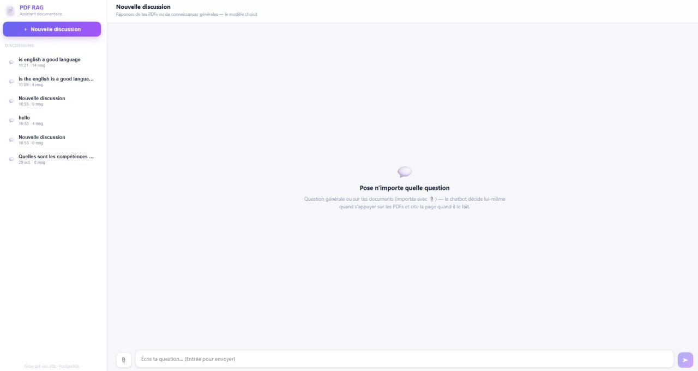

# 📄 PDF-RAG-ASSISTANT

<p align="center">
  
</p>

**Full-Stack RAG Conversational Assistant**

Ask any question — general knowledge or questions about your PDFs. The chatbot intelligently decides whether to answer using its general knowledge or your uploaded documents, providing page-level citations.

> Angular 21 · FastAPI · PostgreSQL 16 · Groq (`openai/gpt-oss-20b`) · Sentence Transformers

---

## ✨ Features

| Feature | Description |
|---|---|
| 🤖 **Hybrid AI Chat** | General questions are answered using the LLM's knowledge; document-related questions use PDF context with page citations. The LLM itself decides whether to use document context. |
| 📎 **PDF Upload** | Drag and drop PDFs into the sidebar or use the attachment button. Automatic indexing with chunking, embeddings, and cosine similarity. |
| 💬 **ChatGPT-Style Sidebar** | Create conversations on the first message, browse chat history, and resume previous conversations. |
| 🧠 **Conversation Memory** | The last 10 dialogue turns are included in the LLM prompt. Complete conversations are persisted in PostgreSQL. |
| 🕐 **Persistent Sessions** | Session ID stored in `localStorage`, allowing conversations to survive page refreshes. |
| 🎨 **Modern Light UI** | Animated message bubbles, typing indicator, toast notifications, drag-and-drop zone, and custom CSS design. |
| 🧪 **Unit Testing** | Vitest for frontend testing; backend structure prepared for pytest. |

---

## 🏗️ Architecture

```text
┌──────────────────┐       HTTP / CORS       ┌──────────────────────────┐
│                  │ ◄─────────────────────► │                          │
│   Angular 21     │                         │   FastAPI Backend        │
│                  │                         │   app/main.py            │
└──────────────────┘                         └────────────┬─────────────┘
                                                         │
                       ┌─────────────────────────────────┼──────────────────────┐
                       ▼                                 ▼                      ▼
             ┌──────────────────┐             ┌──────────────────┐   ┌──────────────────┐
             │   RAG Pipeline   │             │    LLMService    │   │ ChatMemoryStore  │
             │                  │             │                  │   │                  │
             │ PDFLoader        │             │ Groq API         │   │ Chat Sessions    │
             │ TextChunker      │             │ GPT-OSS-20B      │   │ Chat Messages    │
             │ EmbeddingService │             │ Hybrid Prompt    │   │ SQLAlchemy 2.0   │
             │ VectorStore      │             │ Citations        │   │ PostgreSQL 16    │
             │ Retriever        │             │                  │   │                  │
             └──────────────────┘             └──────────────────┘   └──────────────────┘
```

### Backend Architecture

| File | Responsibility |
|---|---|
| `app/main.py` | REST API orchestrator, application lifespan, database initialization, CORS, and upload validation. |
| `app/rag_pipeline.py` | Coordinates the complete RAG pipeline: loading, chunking, embeddings, retrieval, and LLM. |
| `app/pdf_loader.py` | Extracts text from PDF documents using pypdf. |
| `app/text_chunker.py` | Splits documents into overlapping chunks (`CHUNK_SIZE=1000`, `CHUNK_OVERLAP=150`). |
| `app/embedding_service.py` | Generates local embeddings using Sentence Transformers. |
| `app/vector_store.py` | In-memory vector index using NumPy and cosine similarity. |
| `app/retriever.py` | Retrieves the top 4 most relevant document chunks. |
| `app/llm_service.py` | Integrates Groq through the OpenAI-compatible SDK and generates hybrid answers. |
| `app/chat_memory.py` | Manages chat sessions, message history, and conversation titles. |
| `app/database.py` | SQLAlchemy database engine and configuration. |
| `app/db_models.py` | PostgreSQL models for chat sessions and messages. |
| `app/config.py` | Centralized environment configuration. |

### Frontend Architecture

| Component / File | Responsibility |
|---|---|
| `components/chat-page/` | Main interface, sidebar, chat history, PDF upload, and message composer. |
| `components/message-bubble/` | Displays user and assistant messages. |
| `services/pdf-chat-api.service.ts` | HTTP client and API error handling. |
| `models/chat.models.ts` | TypeScript interfaces and API contracts. |

---

## 🛠️ Tech Stack

### Frontend
- Angular 21
- TypeScript
- HTML5 / CSS3
- RxJS
- Vitest

### Backend
- Python 3.13+
- FastAPI
- SQLAlchemy 2.0
- Pydantic
- PyPDF
- NumPy

### Artificial Intelligence
- Groq API
- OpenAI-compatible SDK
- `openai/gpt-oss-20b`
- Sentence Transformers
- `paraphrase-multilingual-MiniLM-L12-v2`
- Local vector embeddings
- Retrieval-Augmented Generation (RAG)
- Cosine Similarity

### Database & Infrastructure
- PostgreSQL 16
- Docker & Docker Compose
- Local in-memory vector store

---

## 🚀 Getting Started

### Prerequisites

Make sure you have installed:

- Python 3.13+
- Node.js 20+
- npm
- Docker Desktop
- A free Groq API key from [Groq Console](https://console.groq.com/)

### 1. Clone the Repository

```bash
git clone https://github.com/raedzayoud/PDF-RAG-ASSISTANT.git
cd PDF-RAG-ASSISTANT
```

### 2. Start PostgreSQL

```bash
cd pdf_rag_api
docker compose up -d
```

PostgreSQL runs on port `5433` on the host machine.

### 3. Configure the Backend

Create and activate a virtual environment:

```bash
python -m venv .venv
```

Windows:

```powershell
.venv\Scripts\activate
```

Install dependencies:

```bash
pip install -r requirements.txt
```

Create your environment file:

```powershell
copy .env.example .env
```

Configure your `.env` file with your Groq API key and PostgreSQL connection details.

### 4. Run FastAPI

```bash
uvicorn app.main:app --reload
```

Backend:

`http://127.0.0.1:8000`

Interactive API documentation:

`http://127.0.0.1:8000/docs`

### 5. Start Angular

Open another terminal:

```bash
cd client
npm install
ng serve
```

Frontend:

`http://localhost:4200`

### 6. Upload Your PDFs

1. Open the Angular application.
2. Upload a PDF using the attachment button or drag and drop.
3. Wait for automatic document indexing.
4. Ask questions about your uploaded documents.
5. Receive answers with PDF filename and page citations.

**Note:** The first startup downloads the embedding model (approximately 500 MB). It is cached locally for subsequent runs.

---

## ⚙️ Environment Variables

Configure your `.env` file using `.env.example`.

Typical configuration includes:

- `GROQ_API_KEY`
- `LLM_MODEL`
- `EMBEDDING_MODEL`
- `CHUNK_SIZE`
- `CHUNK_OVERLAP`
- `TOP_K`
- `DATABASE_URL`
- `CORS_ORIGINS`

**Security:** Never commit your `.env` file or expose your Groq API key. Keep credentials in environment variables and exclude `.env` through `.gitignore`.

---

## 🔌 REST API

Base URL: `http://127.0.0.1:8000`

| Method | Endpoint | Description |
|---|---|---|
| GET | `/api/health` | Check backend status. |
| GET | `/api/sessions` | Retrieve all conversations. |
| POST | `/api/sessions` | Create a new conversation. |
| GET | `/api/sessions/{id}/messages` | Retrieve conversation messages. |
| POST | `/api/chat` | Send a question and receive an AI response. |
| POST | `/api/documents/upload` | Upload a PDF (maximum 20 MB). |
| POST | `/api/documents/sync` | Rebuild the vector index. |
| GET | `/api/documents/status` | Check indexing status. |

### Example Chat Request

```json
{
  "session_id": "5d80a468-0000-0000-0000-000000000000",
  "question": "What is the main objective of this document?"
}
```

### Example Response

```json
{
  "answer": "The main objective is to define...",
  "sources": [
    {
      "filename": "document.pdf",
      "page": 5,
      "similarity": 0.49,
      "snippet": "..."
    }
  ]
}
```

---

## 🧠 How the RAG Pipeline Works

1. **PDF Upload:** The user uploads a PDF document.
2. **Text Extraction:** PyPDF extracts the document content.
3. **Text Chunking:** The content is divided into smaller overlapping chunks.
4. **Embedding Generation:** Sentence Transformers converts chunks into numerical vectors.
5. **Vector Storage:** Vectors are stored in an in-memory NumPy index.
6. **Similarity Search:** The retriever finds the most relevant chunks using cosine similarity.
7. **LLM Processing:** Groq generates the response using the question, conversation history, and available document context.
8. **Source Citations:** When document context is used, the response includes filename and page references.

---

## 🧭 Limitations & Future Improvements

- **In-memory Vector Store:** The vector index is rebuilt at startup. Future improvement: PostgreSQL with pgvector.
- **No Authentication:** Currently designed for local usage. Future improvement: JWT authentication and multi-user support.
- **Conversation Management:** Conversation deletion and renaming are planned.
- **Dark Mode:** Planned for a future release.
- **Testing:** Expand backend coverage with pytest.

---

## 👨‍💻 Author

**Raed Zayoud**

Software Engineer | Full-Stack Developer | AI & RAG Enthusiast

- GitHub: [@raedzayoud](https://github.com/raedzayoud)

---

⭐ If you find this project useful, consider giving it a star!
